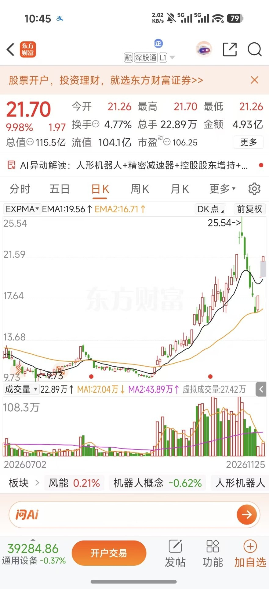
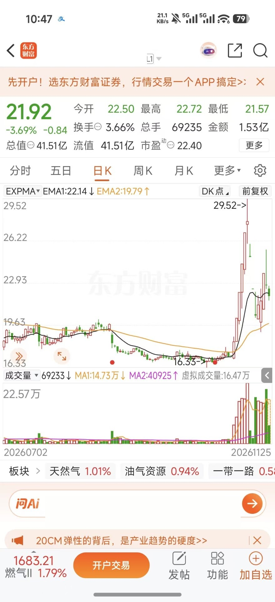
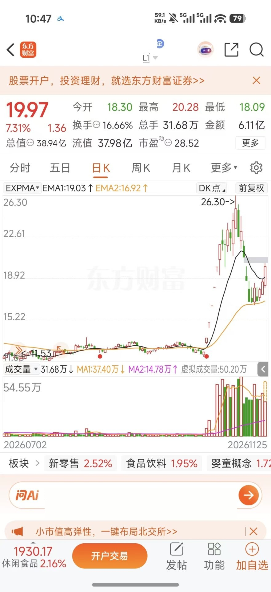

# 胡诌EXPMA选股器

简体中文 | [English](README_EN.md)

> **⚠️ 免责声明（使用前务必阅读）**
>
> - 本项目**仅供个人学习、技术研究与娱乐演示**，**不构成任何投资建议、推荐、邀约或买卖依据**。
> - 程序输出的是**技术形态筛选结果**，不是买入或卖出信号。股市有风险，任何投资决策请自行独立判断，必要时咨询具备资质的专业人士。
> - 作者与贡献者**不保证数据的准确性、完整性、及时性或适用性**，对任何人因使用或无法使用本项目产生的任何直接或间接损失**不承担任何责任**。
> - 本项目使用的行情数据来自第三方服务，**数据版权归原提供方所有**。本项目不内置、不分发、不转售、不公开披露任何行情数据；使用者须自行遵守对应数据提供方的使用条款。
> - 请勿将本项目输出用于任何违法违规用途，亦请勿将缓存数据或结果文件对外分发。

一个用 EXPMA(12, 50) 指标筛选 A 股技术形态的命令行工具，同时可作为 WorkBuddy 技能安装。它寻找的是：**经历一轮带涨停的上涨后，正在回调并且最新交易日收盘价刚好贴近 EMA2（长期线）±1.5% 的个股**——也就是"刚要接近 EMA2、尚未反弹远离"的状态，而不是"曾经触及 EMA2 后已经涨上去"的票。

## 一、策略思路

### 1. 前置过滤（缩小范围）

| 条件 | 默认值 | 说明 |
|------|--------|------|
| 板块 | 排除科创板、北交所 | 代码前缀过滤 |
| 风险股 | 排除 ST / *ST / 退市 | 按名称与数据源 ST 标记过滤 |
| 总市值 | < 300 亿元 | 前置过滤，拉 K 线前执行 |
| 当前股价 | < 50 元 | 前置过滤，拉 K 线前执行 |

这两个阈值可用 `--max-mktcap`（单位：万元）和 `--max-price` 调整。前置过滤能显著减少需要拉取 K 线的股票数量。

### 2. 形态条件

1. **阶段高点**：在最近 150 个交易日中取最高价那天作为高点。
2. **起涨段**：从高点向前 60 个交易日取最低价作为起涨点，阶段涨幅需 ≥ 20%。
3. **涨停要求**：起涨点到高点之间至少出现 1 次涨停（主板按 9.8%，创业板按 19.8% 判定）。这是硬条件。
4. **回调周期**：高点到最新交易日的间隔需 ≤ 10 个交易日；11–12 日会保留为"备选(回调超10日)"，超过 12 日直接排除。
5. **贴近 EMA2**：**只看数据源里最新交易日的收盘价**。收盘价与当日 EMA2 的相对偏离需在 ±1.5% 以内。盘中最低价触及但收盘反弹超过 1.5% 的股票一律排除，也不设"接近中"备选。
   - 因 A 股最小变动单位为 0.01 元，而 EMA2 是浮点值，容差上额外加 0.02 元价格精度缓冲。
   - EXPMA 参数为 EMA1=12 日、EMA2=50 日，与东方财富默认显示一致。

### 3. 评分（仅用于排序）

满足所有硬条件后，按以下维度打分：涨停次数、阶段涨幅、EMA1 是否位于 EMA2 上方、EMA2 是否向上、回调是否缩量（回调期均量 < 上涨期均量 × 0.8）。**评分只决定结果顺序，不影响是否入选。**

### 4. 形态示意

以下三张截图来自东方财富个股详情页，仅用于说明"上涨段 → 涨停 → 回调 → 贴近 EXPMA 线"的形态。**图中股票代码与名称已做脱敏处理**：

| 示例一 | 示例二 | 示例三 |
|--------|--------|--------|
|  |  |  |

注意：这几张图展示的是已经走完的行情（当前价格已远离 EMA2），实际筛选目标是"正在接近 EMA2"的当前状态，二者不同。

## 二、数据源与合规说明

- **主数据源：BaoStock（证券宝）**。免费、免注册，走服务端协议（非网页爬虫），不受财经网站 WAF 风控影响。股票列表含 ST 标记，K 线为前复权日线并带涨跌幅字段。
- **补充数据**：总市值与当前价来自新浪行情快照接口，一次拉取全市场，用于前置过滤。
- **备用数据源**：`--source web` 可切到新浪/东财列表 + 东财/腾讯 K 线，但这些网页接口对高频请求有风控，不推荐使用。
- **更新节奏**：BaoStock 日线为 T+1，交易日约 17:30 后入库当天数据。盘中运行拿到的最新交易日通常是上一交易日。
- **缓存**：K 线缓存在 `output/.cache/`，按"缓存数据末日 vs 最新交易日"判断新鲜度；只要出现新交易日，就只重新拉取数据过期的股票。停牌股有特殊容错，避免每次重复请求。这些缓存文件已被 `.gitignore` 排除。
- **数据合规**：行情数据归各数据提供方所有。本项目不随代码分发任何行情数据。使用者应自行获取并遵守 BaoStock、新浪、东方财富、腾讯等提供方的使用条款，不得转售、分发、泄露或公开披露缓存数据与结果文件。

BaoStock 0.9.4 在 Python 3.13 + 新版 pandas 下 `rs.next()` 会死循环，代码直接读 `rs.data` 规避了该兼容问题。

## 三、安装

需要 Python 3.10 及以上（开发与验证环境为 Python 3.13）。

```bash
git clone <仓库地址> expma-pullback-screener
cd expma-pullback-screener
python -m pip install -r requirements.txt
```

`requirements.txt` 声明 `baostock==0.9.4` 与 `openpyxl==3.1.5`，pandas / numpy 等依赖由 pip 自动安装。**不提交 `vendor/` 二进制目录**，避免不同 Python 版本或操作系统下的兼容问题。

### 作为 WorkBuddy 技能使用

把仓库克隆到 WorkBuddy 技能目录，然后重启 WorkBuddy：

```bash
# Windows
git clone <仓库地址> "%USERPROFILE%\.workbuddy\skills\expma-pullback-screener"

# macOS / Linux
git clone <仓库地址> ~/.workbuddy/skills/expma-pullback-screener
```

技能显示名为"胡诌EXPMA选股器"，图标为目录内的 `_icon.svg`。`_user_meta.json` 不写绝对路径，换设备无需修改。

也可以不装成技能，直接当命令行脚本使用。

## 四、使用

在仓库根目录执行：

```bash
python scripts/screen.py
```

程序会串行扫描过滤后的全市场股票，结果输出到 `output/expma_screen_<时间戳>.csv`、同名 `.json` 和 `.xlsx`。首次全市场扫描约需 20–40 分钟（取决于网络）；同一交易日内再次运行走缓存，通常几秒到几十秒。

> **Excel / WPS 用户请打开 `.xlsx` 文件**：其中「代码」列按文本保存，`002187` 这类前导 0 不会丢。CSV / JSON 保留原始代码字符串，但用表格软件打开 CSV 后一旦保存，前导 0 可能被自动吃掉。

### 常用参数

```bash
python scripts/screen.py --ema2-tol 0.02       # 回踩容差放宽到 ±2%
python scripts/screen.py --max-pullback 8      # 回调周期收紧到 8 个交易日
python scripts/screen.py --min-rise 30         # 阶段涨幅至少 30%
python scripts/screen.py --min-limit-ups 2     # 上涨段至少 2 次涨停
python scripts/screen.py --max-mktcap 2000000  # 市值上限改为 200 亿元（万元）
python scripts/screen.py --max-price 30        # 股价上限改为 30 元
python scripts/screen.py --no-cache            # 忽略缓存，强制重新拉取
python scripts/screen.py --offline             # 离线模式：只用本地已有缓存
python scripts/screen.py --limit 500           # 只扫前 500 只（调试用）
python scripts/screen.py --source web          # 切到网页备用源（不推荐）
python scripts/screen.py --help                # 查看完整参数
```

### 离线模式

`--offline` 完全不发网络请求，合并读取 BaoStock 缓存与早期网页缓存，适合在没有网络时复核已累积的数据。它不判断缓存新鲜度，只看本地已有什么数据。

## 五、结果字段

| 字段 | 含义 |
|------|------|
| 代码 / 名称 / 最新价 / 最新涨幅% | 个股基本信息 |
| 总市值(亿) | 来自新浪快照，前置过滤用 |
| 状态 | `命中` 为主要结果；`备选(回调超10日)` 为回调 11–12 日的边缘情况 |
| 回踩日 / 回踩日EMA2 / 回踩偏离% | 最新交易日与当日 EMA2 的对比 |
| 当前偏离EMA2% | 最新收盘价相对 EMA2 的偏离，越接近 0 越贴合 |
| 起涨日 / 高点日 / 阶段涨幅% | 上涨段识别结果 |
| 涨停次数 | 上涨段内涨停次数 |
| 回调交易日 | 高点到最新交易日的间隔 |
| EMA1 / EMA2 | 最新交易日的 EXPMA 数值 |
| 回调量比 | 回调期均量 / 上涨期均量，< 1 表示缩量 |
| 评分 | 排序用分数，不代表投资价值 |

再次强调：这些字段只是技术形态描述，**不构成任何操作建议**。

## 六、目录结构

```text
.
├── SKILL.md                 # WorkBuddy 技能定义
├── README.md                # 本说明（简体中文）
├── README_EN.md             # 英文说明
├── LICENSE                  # MIT 许可与第三方声明
├── requirements.txt         # Python 依赖
├── _icon.svg                # 技能图标
├── _user_meta.json          # 技能显示名（不含绝对路径）
├── scripts/
│   ├── screen.py            # 主筛选逻辑与命令行入口
│   └── baostock_source.py   # BaoStock 数据源与新浪市值补充
├── references/
│   └── strategy.md          # 策略原理与调参建议
├── docs/screenshots/        # 已脱敏的形态示例图
└── output/                  # 运行结果与缓存（缓存不入库）
```

## 七、许可与再次声明

本项目代码采用 [MIT License](LICENSE)。第三方依赖（BaoStock、pandas、numpy 等）各有其自身许可，随 pip 安装。

> **最终提醒**：本项目是技术形态学习工具，不是投资顾问产品。任何依据其输出进行的交易行为，风险由使用者自行承担。请勿将行情缓存、结果文件或第三方数据对外分发、转售或泄露。

---

*最后重申：仅供娱乐与学习，不构成投资建议。*
