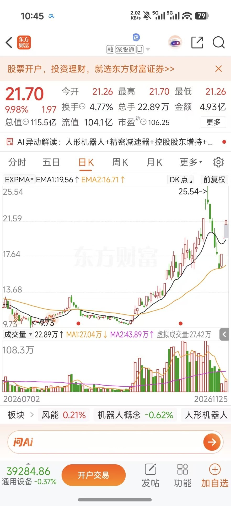
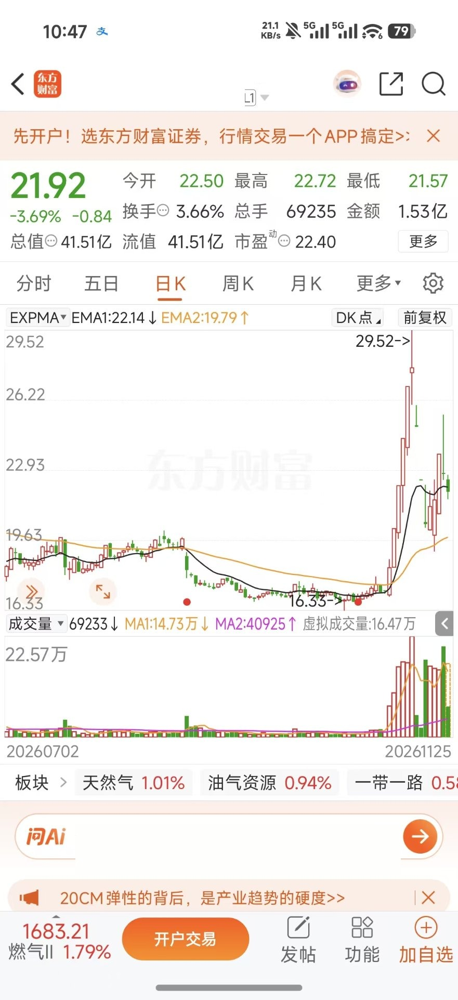
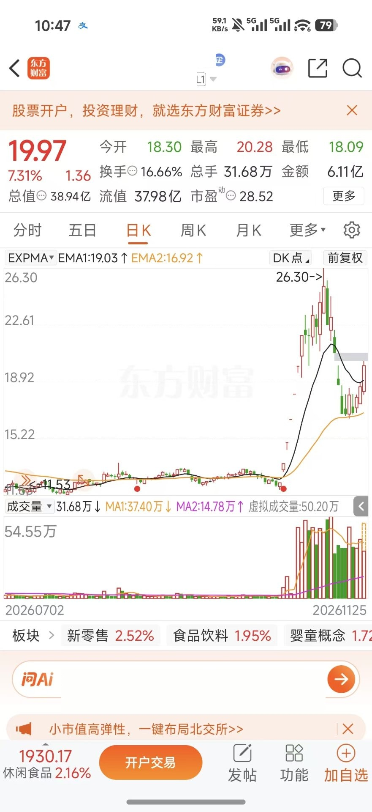

# HuZhou EXPMA Screener (胡诌EXPMA选股器)

[简体中文](README.md) | English

> ## Disclaimer — read before use
>
> - This project is **for personal learning, technical research and entertainment only**. It is **not investment advice, a recommendation, a solicitation, or a basis for any buy/sell decision**.
> - The program outputs **technical pattern screening results**, not buy or sell signals. The stock market involves risk; make your own independent judgment and consult a qualified professional when needed.
> - The authors and contributors **do not warrant the accuracy, completeness, timeliness or suitability** of the data, and **assume no liability** for any direct or indirect loss arising from the use or inability to use this project.
> - Market data comes from third-party services and **the copyright belongs to the respective providers**. This project does not bundle, distribute, resell, or publicly disclose any market data. Users must comply with the terms of service of the relevant providers.
> - Do not use this project for any unlawful purpose. Do not redistribute, resell, leak or publicly disclose cached market data or result files.

A command-line tool that screens A-share stocks using the EXPMA(12, 50) indicator. It can also be installed as a WorkBuddy skill. It looks for stocks that have **completed a run-up containing at least one limit-up day, then pulled back so that the latest trading day's close sits within ±1.5% of EMA2 (the long-term line)** — in other words, stocks that are *just approaching EMA2 and have not yet bounced away*, not stocks that touched EMA2 earlier and have already rallied.

## 1. Strategy

### 1.1 Pre-filters (narrow the universe)

| Condition | Default | Description |
|-----------|---------|-------------|
| Market segment | Exclude STAR Market and Beijing Stock Exchange | Code-prefix filter (688/689 and BSE codes) |
| Risk stocks | Exclude ST / *ST / delisting | Name and data-source ST flags |
| Market cap | < CNY 30 billion (300 亿元) | Applied before any K-line fetch |
| Latest price | < CNY 50 | Applied before any K-line fetch |

The two thresholds can be changed with `--max-mktcap` (unit: CNY 10,000 / `万元`) and `--max-price`. Pre-filtering greatly reduces the number of K-lines that need to be downloaded. Note: `1 亿元 = CNY 100 million`, so `300 亿元 = CNY 30 billion`.

### 1.2 Pattern conditions

1. **Swing high**: the highest high within the most recent 150 trading days.
2. **Run-up leg**: the lowest low within the 60 trading days before the swing high; the run-up gain must be **≥ 20%**.
3. **Limit-up requirement**: at least **one limit-up day** between the run-up start and the swing high (main board: 9.8%, ChiNext: 19.8%). This is a hard condition.
4. **Pullback length**: the interval from the swing high to the latest trading day must be **≤ 10 trading days**. Eleven to twelve days are kept as `Watchlist (pullback >10 days)`; more than 12 days are excluded.
5. **EMA2 touch**: **only the latest trading day's close from the data source is considered**. The relative deviation between that close and the same day's EMA2 must be within **±1.5%**. If the intraday low touched EMA2 but the close bounced more than 1.5% away, the stock is excluded; there is no "almost there" fallback bucket.
   - Because A-shares tick at CNY 0.01 while EMA2 is a floating-point value, an extra **CNY 0.02** precision buffer is added to the tolerance.
   - EXPMA parameters are EMA1 = 12 days and EMA2 = 50 days, matching Eastmoney's defaults.

### 1.3 Scoring (ordering only)

Once all hard conditions are met, a score is assigned using: number of limit-ups, run-up gain, whether EMA1 is above EMA2, whether EMA2 is rising, and whether volume contracted during the pullback (pullback average volume < run-up average volume × 0.8). **The score only determines result order; it does not affect selection.**

### 1.4 Pattern examples

The three screenshots below come from Eastmoney stock detail pages and illustrate the shape "run-up → limit-up → pullback → approaching the EXPMA lines". **Stock names and codes have been redacted.**

| Example 1 | Example 2 | Example 3 |
|-----------|-----------|-----------|
|  |  |  |

Note: these charts show already-completed moves (the current price is far from EMA2). The actual screening target is the *current state of approaching EMA2*, which is different.

## 2. Data source and compliance

- **Primary source: BaoStock (证券宝)**. Free, no registration, server protocol (not a web scraper), and unaffected by financial-site WAF controls. The stock list includes ST flags; K-lines are forward-adjusted daily bars with percentage-change fields.
- **Supplementary data**: market cap and latest price come from a Sina snapshot, fetched once for the whole market and used for pre-filtering.
- **Fallback source**: `--source web` switches to Sina/Eastmoney lists plus Eastmoney/Tencent K-lines. These web endpoints have rate controls for frequent requests and are not recommended.
- **Update cadence**: BaoStock daily bars are T+1; the current trading day's data is usually available after about 17:30 China time. Running during market hours normally returns the previous trading day as the latest.
- **Cache**: K-lines are cached under `output/.cache/`. Freshness is decided by comparing the last cached date with the latest trading day; once a new trading day appears, only stale stocks are re-fetched. Suspended stocks have special handling to avoid repeated requests. Cache files are excluded by `.gitignore`.
- **Data compliance**: market data belongs to its providers. This project ships no market data with the code. Users must obtain data themselves and comply with the terms of BaoStock, Sina, Eastmoney, Tencent and other providers. Do not resell, distribute, leak or publicly disclose cached data or result files.

Compatibility note: BaoStock 0.9.4 can loop indefinitely on `rs.next()` under Python 3.13 with newer pandas. The code reads `rs.data` directly to avoid this issue.

## 3. Installation

Python 3.10 or newer is required (development and validation used Python 3.13).

```bash
git clone <repository-url> expma-pullback-screener
cd expma-pullback-screener
python -m pip install -r requirements.txt
```

`requirements.txt` declares `baostock==0.9.4` and `openpyxl==3.1.5`; pandas, numpy and other dependencies are installed automatically by pip. The `vendor/` binary directory is **not committed**, avoiding compatibility issues across Python versions and operating systems.

### Install as a WorkBuddy skill

Clone the repository into your WorkBuddy skills directory, then restart WorkBuddy:

```bash
# Windows
git clone <repository-url> "%USERPROFILE%\.workbuddy\skills\expma-pullback-screener"

# macOS / Linux
git clone <repository-url> ~/.workbuddy/skills/expma-pullback-screener
```

The skill display name is "胡诌EXPMA选股器" and its icon is `_icon.svg` in the directory. `_user_meta.json` contains no absolute paths, so no changes are needed on a new device.

You can also skip the skill installation and use the script directly from the command line.

## 4. Usage

From the repository root:

```bash
python scripts/screen.py
```

The program serially scans the filtered universe and writes results to `output/expma_screen_<timestamp>.csv`, a matching `.json`, and an Excel-friendly `.xlsx`. A first full-market scan takes about **20–40 minutes** depending on the network; reruns on the same trading day use the cache and usually finish in seconds to tens of seconds.

> **Excel / WPS users: open the `.xlsx` file.** Its code column is stored as text, so leading zeros in codes such as `002187` are preserved. The CSV/JSON keep the raw code strings, but spreadsheet apps may strip leading zeros if you open the CSV and save it.

### Common options

```bash
python scripts/screen.py --ema2-tol 0.02       # widen EMA2 tolerance to ±2%
python scripts/screen.py --max-pullback 8      # tighten pullback length to 8 trading days
python scripts/screen.py --min-rise 30         # require at least 30% run-up gain
python scripts/screen.py --min-limit-ups 2     # require at least 2 limit-ups in the run-up
python scripts/screen.py --max-mktcap 2000000  # market cap ceiling to CNY 20 billion (unit: CNY 10,000)
python scripts/screen.py --max-price 30        # price ceiling to CNY 30
python scripts/screen.py --no-cache            # ignore cache and force re-fetch
python scripts/screen.py --offline             # offline mode: use only existing local cache
python scripts/screen.py --limit 500           # scan only the first 500 stocks (debugging)
python scripts/screen.py --source web          # switch to the fallback web source (not recommended)
python scripts/screen.py --help                # show all options
```

### Offline mode

`--offline` makes no network requests. It merges BaoStock cache with older web-source cache, which is useful for reviewing accumulated data without connectivity. It does not check cache freshness; it simply uses whatever local data exists.

## 5. Output fields

The raw CSV/JSON headers are Chinese. The table below maps them to English.

| Raw column | Meaning |
|------------|---------|
| 代码 | Stock code |
| 名称 | Stock name |
| 最新价 | Latest close price (CNY) |
| 最新涨幅% | Latest daily change (%) |
| 总市值(亿) | Market cap in units of CNY 100 million, from the Sina snapshot |
| 状态 | `命中` = Hit; `备选(回调超10日)` = Watchlist (pullback 11–12 days) |
| 回踩日 | Touch date (the latest trading day) |
| 回踩方式 | Touch method; currently always `收盘价` (close price) |
| 回踩日EMA2 | EMA2 on the touch date |
| 回踩偏离% | Deviation on the touch date (%) |
| 当前偏离EMA2% | Latest close deviation from EMA2 (%); closer to 0 is tighter |
| 起涨日 | Run-up start date |
| 高点日 | Swing-high date |
| 阶段涨幅% | Run-up gain (%) |
| 涨停次数 | Number of limit-up days in the run-up |
| 回调交易日 | Pullback trading days from the swing high to the latest day |
| EMA1 / EMA2 | EXPMA values on the latest trading day |
| 回调量比 | Pullback average volume / run-up average volume; < 1 means contraction |
| 评分 | Ordering score; not an investment value |

Again: these fields only describe technical patterns and **do not constitute any operating recommendation**.

## 6. Project structure

```text
.
├── SKILL.md                 # WorkBuddy skill definition
├── README.md                # Chinese documentation
├── README_EN.md             # English documentation
├── LICENSE                  # MIT license and third-party notice
├── requirements.txt         # Python dependencies
├── _icon.svg                # Skill icon
├── _user_meta.json          # Skill display name (no absolute paths)
├── scripts/
│   ├── screen.py            # Main screening logic and CLI entry point
│   └── baostock_source.py   # BaoStock data source + Sina market-cap enrichment
├── references/
│   └── strategy.md          # Strategy rationale and tuning notes
├── docs/screenshots/        # Redacted pattern examples
└── output/                  # Results and cache (cache not committed)
```

## 7. License and final notice

The project code is released under the [MIT License](LICENSE). Third-party dependencies (BaoStock, pandas, numpy, etc.) carry their own licenses and are installed via pip.

> **Final reminder**: this project is a technical-pattern learning tool, not an investment advisory product. Any trading based on its output is entirely at the user's own risk. Do not distribute, resell, or leak market-data caches, result files, or third-party data.

---

*Once more: for learning and entertainment only. Not investment advice.*
